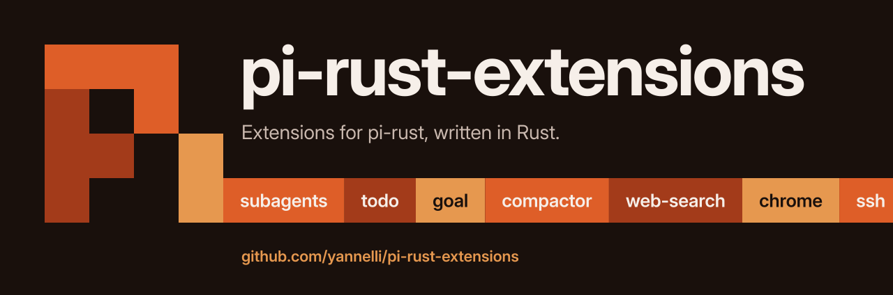

<p align="center">
  
</p>

# pi-rust-extensions

Extensions for [pi-rust](https://github.com/yannelli/pi-rust), written in Rust.

All extensions build into one binary, `pi-rust-ext`. Each release attaches the binary for each supported target, a signed `index.json`, and its signature. pi-rust checks the Ed25519 signature of the index and the SHA-256 of each download before it installs an extension.

## Install an extension

```sh
pi install marketplace:<name>
```

For example, `pi install marketplace:todo`. You can also open `/extensions` in the pi TUI to browse, install, and remove extensions.

## Extensions

### Agents and workflow

| Extension | Description |
| --- | --- |
| [`subagents`](extensions/subagents/README.md) | Delegate tasks to child pi agents (explore, build, advisor, custom) in the foreground, background, or in parallel. |
| [`todo`](extensions/todo/README.md) | Phased todo plans with dependencies, per-subagent scopes, a widget above the editor, and `/todos`. |
| [`goal`](extensions/goal/README.md) | Persistent goals, task trees, autonomous continuation, and completion audits. |
| [`ask-user-question`](extensions/ask-user-question/README.md) | Tabbed questionnaire tool (`ask_user_question`) for structured answers from the user. |
| [`background-tasks`](extensions/background-tasks/README.md) | Durable background shell jobs with output and task management. |
| [`rewind`](extensions/rewind/README.md) | Per-turn shadow git checkpoints and conversation restoration. |

### Context and memory

| Extension | Description |
| --- | --- |
| [`compactor`](extensions/compactor/README.md) | Zero-LLM structured compaction summaries or LLM summaries with an active-work header, plus session recall and context budget tools. |
| [`observational-memory`](extensions/observational-memory/README.md) | Records observations and reflections during a session, uses them as the compaction summary, and adds a recall tool. |
| [`context-include`](extensions/context-include/README.md) | Expand `@path.md` lines in `AGENTS.md` context files into an extra system prompt section. |

### Tools

| Extension | Description |
| --- | --- |
| [`web-search`](extensions/web-search/README.md) | Search the web and read URLs with model-native and search providers. |
| [`chrome`](extensions/chrome/README.md) | Control Chrome through the DevTools Protocol with session authorization. |
| [`computer-use`](extensions/computer-use/README.md) | Observe desktop windows and send keyboard and pointer input. |
| [`ssh`](extensions/ssh/README.md) | Reusable SSH profiles, shared connections, remote tools, and remote bash mode. |
| [`lens`](extensions/lens/README.md) | Post-write formatters, linters, type checks, LSP diagnostics and a read-before-edit guard. |
| [`typesafe`](extensions/typesafe/README.md) | Structured TypeSafe judgments with session controls and usage limits. |

### Providers

| Extension | Description |
| --- | --- |
| [`ollama`](extensions/ollama/README.md) | Discovers models from a local Ollama, registers the `ollama` provider, and manages models with `/ollama`. |
| [`subscription-router`](extensions/subscription-router/README.md) | Several ChatGPT Codex and Anthropic subscription accounts as provider slots, quota-aware slot selection, 429 failover, and `router/<profile>` virtual models. |

### Claude Code and Codex

| Extension | Description |
| --- | --- |
| [`hooks`](extensions/hooks/README.md) | Run Claude Code and Codex hooks (PreToolUse, PostToolUse, Stop, and more) from pi, with per-hook trust. |
| [`claude-marketplace`](extensions/claude-marketplace/README.md) | Add Claude Code plugin marketplaces and install their commands, skills, agents, hooks, and MCP servers into pi. |

### Terminal

| Extension | Description |
| --- | --- |
| [`statusline`](extensions/statusline/README.md) | Configurable footer status line: builtin presets and themes, command scripts, Claude Code, Cursor, and Codex status lines, and the `/statusline` editor. |
| [`iterm2`](extensions/iterm2/README.md) | iTerm2 integration: tab color follows the agent state, session badge, status bar user variables, attention requests, and `/terminal-setup`. |

## Layout

| Path | Contents |
| --- | --- |
| `crates/pi-ext-sdk` | Rust SDK for the pi-rust native extension protocol |
| `crates/pi-rust-ext` | The multi-call binary |
| `extensions/<name>` | One crate for each extension |
| `crates/marketplace-index` | Writes the release `index.json` |
| `marketplace.json` | Catalog data for the release index |
| `scripts/verify-release.sh` | Checks the signature and archives of a release |

## Docs

See [docs/INDEX.md](docs/INDEX.md). [docs/release.md](docs/release.md) tells how to make and verify a release.
